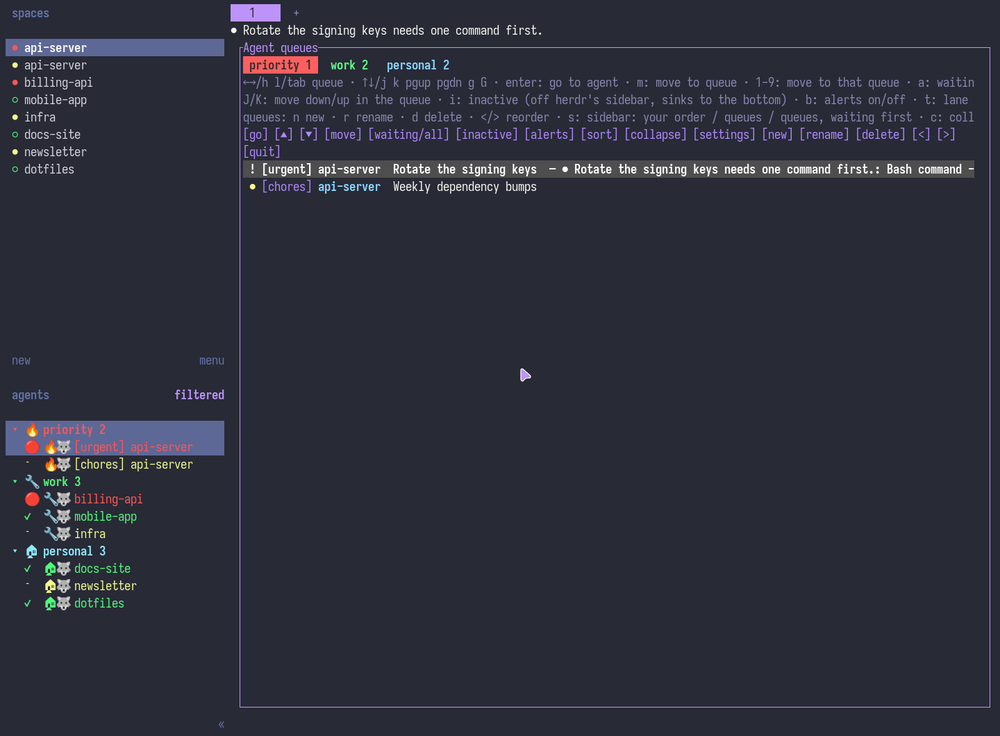
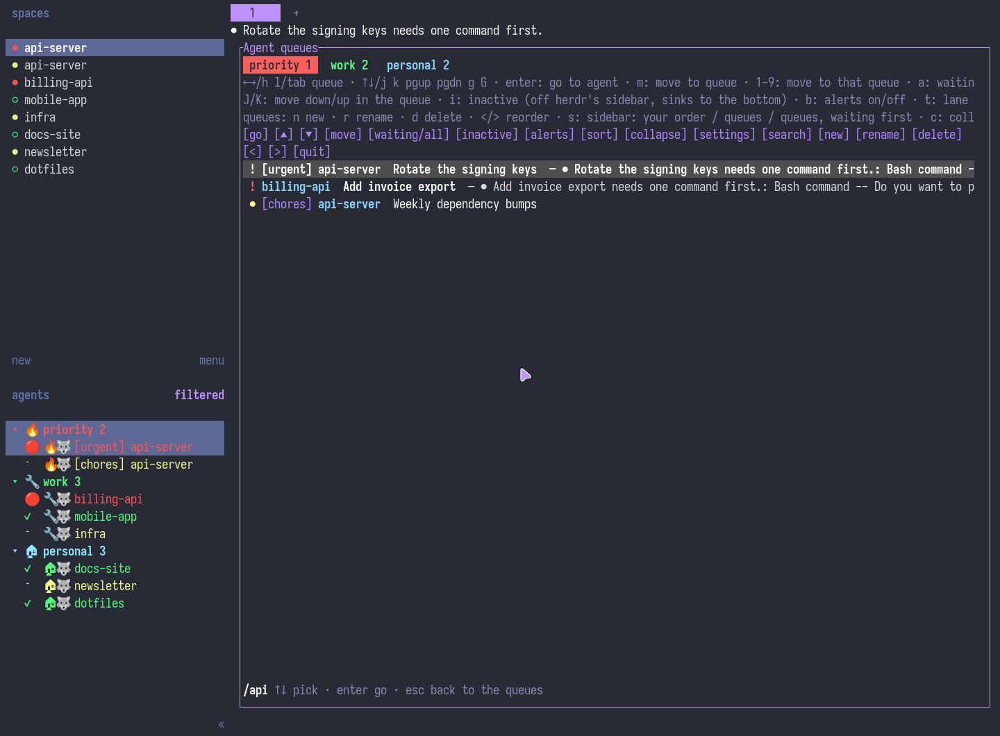

# herdr-queues

A [herdr](https://herdr.dev) plugin: your own **queues** (personal, work, anything you name) of the agents waiting on
you, **on every machine herdr knows**, each with one line saying what it needs. Press Enter and the herdr window
switches to that agent's machine and focuses it.



The sidebar (bottom left) grouped by queue: 🔥 priority, 🔧 work, 🏠 personal, each agent with its status (🔴 asking
you something, ✓ done, a spinner while it works), its machine's icon and its workspace; two agents on one repo told
apart by their lanes, `[urgent]` and `[chores]`. Over it, the popup (your key, below): a tab per queue, the waiting
agents first, each with what it needs. (Made-up agents in a throwaway herdr.)

- **A queue lists all its agents**, the waiting ones first: blocked (`!`, it asked you something), then done (`✓`, it
  finished). **Your own order:** `J` / `K` (or the ▲ ▼ buttons) move the selected agent down or up, and from then on
  the queue keeps your order; agents you never placed follow it, by status. Inactive agents sit at the bottom. The number on a tab counts the waiting ones. `a` narrows the list to the waiting ones.
- **The summary** is the agent's own `※ recap:` line when Claude Code printed one, else the question on its screen
  (a permission prompt is named by its tool and description), else its last line of output.
- **Every machine**: the server you are on plus every enabled machine in `herdr machine list`. Agents on this
  server show bare; the rest as `machine · workspace`. A machine that doesn't answer is skipped for a minute.
- **One line per agent**, in the Dracula palette; the list scrolls with the selection (↑↓, PgUp/PgDn, `g`/`G`),
  and the popup opens at 98 % × 96 % of the window.
- **Fast**: the list opens at once and fills in the background (about two seconds for five machines); keys never
  wait on the network.
- **Filing agents**: every agent starts in `unsorted`, which always lists all of them. `m` opens a list of the
  other queues (or a new one) to move the selected agent into; `1`-`9` moves it straight to that queue.
- **The mouse**: a row of buttons under the help (go, ▲, ▼, move, waiting/all, inactive, alerts, sort, new, rename, delete,
  `<` `>`, quit) does what its key does. Click a tab to open it, a line to select it, the selected line again to go
  to it; the wheel scrolls the list. In the move box, click a queue (outside the box cancels).
- **Your own queues**: `n` new, `r` rename, `d` delete (its agents go back to unsorted), `<` / `>` reorder.
  Membership follows the agent's session and terminal, and last its machine and folder, so it survives a herdr
  restart, a `/clear`, and a restart into a new pane (an agent found by one key is given its new ones).

## Install

```sh
herdr plugin install Benjmhart/herdr-queues
```

Bind a key in `~/.config/herdr/config.toml`:

```toml
[[keys.command]]
key = "prefix+u"
type = "plugin_action"
command = "benjmhart.queues.open"
description = "agents waiting on me, by queue"

[[keys.command]]
key = "prefix+/"
type = "plugin_action"
command = "benjmhart.queues.search"
description = "find any agent on any machine"
```

Python 3 standard library only. Install it on every machine you connect to with `herdr machine`, since the popup
runs on whichever machine the window is showing.

## Search: any agent, on any machine

`/` in the popup, or the `search` action straight from a key (`prefix+/` above), searches every agent on every
machine at once, whatever its queue. Type words: an agent matches when each word appears in its machine, lane,
queue, workspace, title or folder (`api urgent`, `laptop docs`). Waiting agents come first. ↑↓ pick one, enter goes
there (to another machine too), backspace edits, esc leaves the search (or closes the popup it opened).



## Several machines: setup

The sections below explain each part; this is the whole list. Your **desk** is a machine you sit at (its herdr window
connects to the others with `herdr machine`).

1. **The plugin on every machine, the same version.** The shared queues change meaning between releases (0.28's sort
   order, 0.31's folder keys). The popup opens with a line naming any machine on another version (`?` = older than
   0.32, which doesn't report one). Until they match, an older machine's watcher leaves a newer machine's sidebar
   labels alone (from 0.36.1; before it, an older watcher repainted them every minute without the newer fields, so
   0.36's lanes came and went). An outbound-only machine can only be updated from itself.
2. **`herdr machine add` for each other machine, on each desk.** The popup lists the server it runs on plus those.
3. **ssh from each desk to each machine, with no prompt** (`BatchMode`: a key or agent, the same target herdr uses).
   The watcher asks each machine its hostname once (`uname -n`, cached in `hosts.json` in the plugin's state), so a
   target may be an alias or an IP. Until it has asked (or if it can't), the name is guessed from the target
   (`user@devbox.lan` → `devbox`), and a wrong guess files that machine's agents under a second name.
4. **The watcher on each desk** (`queues.py watch`, with your desktop session; `--no-notify` where you don't want
   notifications). It carries out jumps, keeps the queues the same everywhere, keeps the sidebar marks up, and lists
   every machine's agents for the heading counts.
5. **The keybinding on each machine's herdr** (the popup runs where the window is).
6. **The spinner's speed per machine.** Each frame is a sidebar update per working agent that the herdr server
   redraws, so the spinner is most of what this plugin costs herdr. At 4 frames a second it took ~6 % of a core on an
   i3-3227U, and 10-17 % of one on a 16-core desktop with about six agents working (3-6 % with the spinner paused),
   so the default is 1 frame a second (since 0.42.0; it was 4). Set it per machine, from any machine (the setting
   travels with the queues): `queues.py host netbook spin 2` (frames a second, up to 10), `spin off` (the mark stays
   still: no cost), `spin default`; or in the popup's settings, the machine's row.

Which machine needs ssh to which:

| Feature | Who connects | Without it |
|---|---|---|
| Popup lists another machine's agents | popup's server → machine (herdr's own connection) | that machine's watcher sends its list instead (outbound from it) |
| Enter: jump to an agent | desk watcher → every machine (ssh, follows requests) | Enter on that machine's agents does nothing visible |
| Same queues everywhere | desk watcher → every machine (ssh) | each machine keeps its own copy |
| Sidebar marks, headings, inactive | each machine for itself; desk watcher → machines once a minute | that machine's sidebar updates only on its own events |
| Heading counts from other machines | that machine's watcher → each machine (ssh), or the machine sends its own | its headings count only its own agents |
| `s`: reorder workspaces | popup's server → machine (ssh) | that machine keeps its order |
| Hostnames | desk watcher → machine (ssh, once) | guessed from the ssh target |

**An outbound-only machine** (nothing can ssh into it) works when it is a desk: its watcher reaches the others, and it
sends its own agents to them so their popups list it. What can't reach it: another desk's watcher (so jumps and
queue changes from there arrive only through its own watcher), and an update of the plugin from elsewhere.

## The sidebar in queue order

`s` in the popup sorts herdr's sidebar on every machine by your queues: workspaces holding agents of the first queue
first (blocked, then done, idle, working), then the next queue, then the rest as they were. `s` again puts back your
own order, saved when you left it; workspaces made since go last. herdr's agent panel follows the workspace order
(`ui.agent_panel_sort = "spaces"`, the default), so it reorders too. Another machine is reordered over ssh
(`workspace.move` is a socket call the CLI lacks), so one this machine cannot ssh to keeps its order.

## Inactive agents: off herdr's sidebar, still here

`i` in the popup marks the selected agent inactive (`i` again undoes it): herdr's sidebar stops listing it, on every
machine, while the popup keeps it in its queue, marked "· inactive", and the watcher stops notifying about it. It is
herdr's own agent view (`agent.view.set`, the sidebar header reads "filtered"): the agent's pane carries the token
`queues_inactive` on its own server, and every server gets a view hiding panes with that token. A token rather than a
pane id, because a saved-machine client applies the selected server's view to every machine's agents, and pane ids
repeat across machines. Views and tokens don't survive a herdr restart, so the watcher puts them back once a minute;
the mark itself is kept by the agent's session and terminal, like queue membership. `herdr agent list` is unchanged.

## Jumping to another machine: run the watcher where you sit

A plugin can't switch the herdr window to another machine
([herdr #5904](https://github.com/herdrdev/herdr/issues/5904), not planned), and the popup runs on the server the
window is showing, which may have no way back to your screen. So:

1. Enter in the popup writes a one-line request (`<host> <pane>`) to the plugin's state on that server.
2. `queues.py watch`, running on the machine you sit at, follows that file on every machine (`ssh <machine> tail
   -F`, the same ssh herdr uses) and drives the window showing the requesting machine: `prefix+a` (Goto), `/`, the
   machine's label, Enter (which switches the window), then `herdr --machine M agent focus P`. About 0.6 s.

Start the watcher with your desktop session, e.g. in xmonad's startup hook or i3/sway `exec`:

```sh
python3 "$(ls -dt ~/.config/herdr/plugins/github-installations/benjmhart.queues-*/*/checkout/queues.py | head -1)" watch
```

It drives the window with what your desktop offers (found even when the watcher lacks the session's environment):

| Desktop | Find and focus the window | Keys |
|---|---|---|
| X11 (any window manager) | `xdotool` | `xdotool` |
| sway | `swaymsg` | `wtype` |
| Hyprland | `hyprctl` | `wtype` |
| KDE Plasma (Wayland) | `kdotool` | `ydotool` (+ `ydotoold` running) |
| GNOME (Wayland) | the [Window Calls](https://extensions.gnome.org/extension/4724/window-calls/) extension | `ydotool` (+ `ydotoold` running) |

The keys that open Goto come from your herdr `config.toml` (`[keys] prefix` and `goto`, herdr's defaults when unset).
Return is pressed only when the focused pane is seen not to have received the typed machine name: if Goto didn't
open, the keys went to that pane, and the line is cleared (ctrl+u) instead of run. The window title must keep its
default shape, `{hostname}: {workspace}` (a `herdr: ` prefix is fine). Without a watcher, Enter on
this server's own agents still works; on another machine's it does nothing visible.

`queues.py standalone` runs the same list outside herdr (bind it to a desktop key); it drives the window itself.

### Windows

The plugin runs on herdr's Windows build (Windows 11, herdr 0.9.5). Windows' own `python3` is a Microsoft Store stub,
so install Python with python.org's **Python install manager**, which answers to `python3`, then
`python3 -m pip install windows-curses` for the popup. The watcher drives Windows Terminal with user32 and SendKeys
through one resident PowerShell; start it at logon without a console window, e.g. a Startup-folder shortcut to:

```
pythonw <the plugin's folder>\queues.py watch
```

(`herdr plugin list` prints the folder.) It reaches your other machines over ssh as on Linux; those machines run Linux
or macOS (a WSL distro on the same PC works as one: add it with `herdr machine add`). Under WSL, herdr inside WSL
uses the same Windows driver through `powershell.exe`.

### macOS

Tested on Arch Linux and macOS 14 (Sonoma; an Intel VM, herdr 0.9.5 from herdr.dev's `install.sh`, the Command Line
Tools' `python3` 3.9.6) on 2026-11-19: the tests; the plugin linked into a real herdr (sidebar labels, the spinner, the
blocked mark, the refresh and focus hooks); the popup and search, in an attached client and on their own; and the
pieces other machines run there over ssh (the request tail, the shared queues, the relay, socket calls), run locally,
not yet from another machine. **Not on macOS:** the watcher's window switching and its notifications: it drives
X11, Wayland and Windows windows, and macOS has none of its tools, so a Mac is a machine you reach, not the desk the
watcher runs on. macOS's own `python3` is 3.9: it works; Goto keys are read only on 3.11+, which a Mac never needs.

## One set of queues on every machine

Each save also goes down the same request channel, and the watcher keeps the master copy on your desk and writes it
to every machine, so the popup on any machine opens with the same queues. A watcher only carries out a jump when its
focused window is a herdr window showing the requesting machine and the screen is not locked, so watchers on other
desks (locked, or showing something else) stay still. Without a watcher, each machine keeps its own queues.

Every copy carries the time it was saved, and no machine's copy is ever replaced by an older one: a watcher starting
up, or a popup left open while you sorted somewhere else, used to overwrite newer queues and your J/K order. An open
popup also re-reads the queues when another machine changes them.

## The queue in herdr's sidebar

Each agent's pane carries its queue as a token, `$queues_queue`, for herdr's agent rows: the queue's icon when it has
one, else its name (nothing while unsorted). An icon is one character, so a narrow sidebar keeps its width for the
workspace name (herdr cuts a row at its end):

```toml
[ui.sidebar.agents]
rows = [["state_icon", "$queues_queue", "workspace", "machine", "tab"]]
```

    python3 queues.py icon priority 🔥     # set; synced to every machine like the queues
    python3 queues.py icon priority        # clear: the name shows again

herdr has no templates of its own: a row is a list of tokens it joins with ` · ` (none after `state_icon`), and
`"$a$b"` is refused. For the icons and the name with no divider, use `$queues_label`: the queue's
icon, the machine's icon ([herdr-machine-icons](https://github.com/Benjmhart/herdr-machine-icons)' `$machine_icon`, when
installed) and the workspace name in one token, `🔥🐭 billing-api`. The watcher refreshes it every minute, so a
renamed workspace shows within one.

```toml
rows = [["state_icon", "$queues_label"]]
```

**Opt-in: `s` in the popup cycles the sidebar:** your own workspace order (plain labels) → queue order, static →
queue order, automatic (every minute, blocked and finished agents float to the top of their queue). Off, `$queues_label`
is only the workspace name, so a row built on it still reads like herdr's own; a row without `$queues_label` is never
touched, so other plugins or herdr's defaults keep the sidebar.

### Settings: `,` in the popup

`,` or the `[settings]` button lists every sidebar setting: each queue (emoji, colour, collapsed), each machine (emoji,
colour), headings, colour by, status marks, spinner. Everything is a list you can click, scroll or pick by number;
emoji and colours come from lists (typing an emoji is optional). Changes sync to every machine like the queues. The
same from a shell:

    python3 queues.py headings queue            # a heading over each queue (or: machine, off)
    python3 queues.py collapse work             # collapse/open a queue (or `c` in the popup): one row, "▸ work +3"
    python3 queues.py icon priority 🔥          # a queue's emoji
    python3 queues.py color priority red        # red orange yellow green cyan purple pink grey (Dracula), none
    python3 queues.py host desktop icon 🐺   # a machine's emoji (overrides herdr-machine-icons), or: color purple
    python3 queues.py host netbook spin 1      # a machine's spinner frames a second (off: still; default: 1)
    python3 queues.py colorby machine           # colour rows by queue (default) or by machine
    python3 queues.py mark own                  # status marks drawn by the plugin: indented groups, spinner
    python3 queues.py spinner on                # working agents spin (needs mark own)
    python3 queues.py entries on                # experimental: clickable headings, entries of their own

A collapsed queue keeps one row: its most urgent agent (blocked, then finished), under `▸ name +N`. herdr's sidebar
doesn't pass clicks to plugins, so a heading can't be clicked open or shut: use `c` or the settings, or try
clickable headings below.

**Clickable headings (experimental): `queues.py entries on`.** Each queue's heading becomes an entry of its own: an
empty workspace whose pane is reported to herdr as an agent (kind `muse`: herdr drops a kind it doesn't know) and
labelled with the heading. Clicking it collapses or opens the queue, and focus goes back to where you were. Needs `s`
on (queue or auto order) and `headings queue`; turn either off, or `entries off`, and the heading workspaces are
closed.

With clickable headings the agents list is **one list for every machine**, not a block per machine: every agent
carries a `queues_rank` token (its queue, your `J`/`K` order, in auto order its status, then machine and workspace)
and every server's agent view sorts by it, so each queue has one heading with its agents from all machines under it.
The view of the server you are looking at applies to the whole list, so every server keeps a set of headings and its
view shows only its own (token `queues_heading_host`); a click lands on the server you are looking at. Every queue
gets a heading, empty or not (`unsorted` last). Its counts (see the heading template below) cover every machine:
the server's own agents as they are, the others as the watcher on that machine last listed them (once a minute;
machines it can't reach from what they send it). With no watcher running there, a heading counts only its own
server's agents. What it costs:

- herdr reports a click and a keyboard switch alike, so **landing on a heading by any route toggles it**: cycling
  workspaces with the keyboard, or picking it in `prefix+a`. Focus is handed back, with a brief flash.
- The heading workspaces show in herdr's spaces list and in `herdr workspace list` (named `▾ 🔥 priority`).
- One click toggles; a double click toggles twice.
- The plugin's own popup, notifications and nags ignore them.

If herdr ever passes sidebar clicks to plugins ([herdrdev/herdr discussion
#5806](https://github.com/herdrdev/herdr/discussions/5806)), this gives way to the in-row headings.

**Your config.toml rows** come from `python3 queues.py rows`; paste its output once. They don't change with colours,
emoji or headings (colours are an invisible marker in the text, matched by fixed rules), only with `mark`.

**Status marks.** With `mark herdr` the row starts with herdr's own `state_icon`. herdr can't pad before it and indents
an entry's second line by two, so the first agent under a heading sits two columns right of the rest. With `mark own`
the plugin draws the mark as coloured emoji: 🔴 blocked on an approval or question dialog (its name red too; a Claude permission dialog herdr misses, still "working" to it, is caught on screen within 2 s); 📝 a prompt you typed into it and haven't sent; ❓ stopped
on a question to you, ❔ once you have looked at it; ✔ finished (its row green), ✓ once you have looked at it; ⏳ stopped but running
its own background shell (nothing needed from you); a turning Nerd Font arc while working (needs a Nerd Font; Symbols Nerd Font is enough); nothing when idle.
"A question" is read from a Claude session's transcript (its last reply ends a paragraph with `?`), background work
from Claude Code's footer (`· 1 shell`), a draft from its input box (dim suggestions don't count), and "looked at" is focusing the agent since it stopped (herdr's own seen
state is per client). A mark can colour its row (blocked red, done green, working yellow by default): a herdr rule
colours a whole token, so the spinner can't be yellow on its own. Every mark, its colour and each spinner frame are
settings, synced to every machine:

    python3 queues.py status done ✅               # a mark: blocked draft asks asks_seen done done_seen background idle working unknown
    python3 queues.py status working color none    # the row's colour: red orange yellow green cyan purple pink grey, or none
    python3 queues.py status spin '◐ ◓ ◑ ◒'        # spinner frames, space-separated; `default` puts any of them back
 and pads it, so every
heading sits flush left and every agent under it two columns in (herdr indents the first by two; the rest pad to match).
Under headings the heading carries the colour and names stay in the bright text colour; with clickable headings
(below) agents sit one column in. Spinners: `queues.py spin`, started by herdr with the server, turns
working marks four times a second on its own machine.

A herdr rule colours a whole token, never one character, so the own marks are emoji: they bring their own colour
and the name stays bright. With `mark herdr`, a clickable heading shows herdr's `unknown` state icon, a grey `·`.

### Info tokens

Written on each agent's machine as it changes, for rows or the label template:

| Token | Values |
|---|---|
| `$model` | `opus`, `sonnet`, `haiku`, `fable` (else the model id), from the Claude session's transcript |
| `$gitstatus` | `clean`, `dirty`, `ahead`, `behind`, `diverged`, `conflict` (the pane's folder; nothing outside a repo) |
| `$usage` | **Claude Code only**: context used, a bare number 0-100 (so herdr's `gt`/`lt` rules can colour it; `{usage_pct}` in the label adds `%`), from `~/.local/state/claude-ctx/<session>` (remaining %, written by a Claude status line) |

    python3 queues.py badge gitstatus dirty ±   # an emoji or symbol instead of the word (no third argument clears)
    python3 queues.py badge model opus 🟣

**Combining tokens without separators:** herdr puts ` · ` between a row's tokens, so put badges in the label template
instead; any token works there by name:

    python3 queues.py badge gitstatus dirty ±
    python3 queues.py badge model opus 🟣
    python3 queues.py label '{queue}{machine} {workspace} {model}{gitstatus}'   # 🔥🐭 billing-api 🟣±


Its layout is yours, synced to every machine like the queues:

    python3 queues.py label                                  # show it: {queue}{machine} {workspace}
    python3 queues.py label '{machine} {workspace} {queue}'  # set it
    python3 queues.py label default                          # back to the default

It is a template. Fields: `{queue}` (icon, or name when it has none; empty while unsorted), `{machine}`
(`$machine_icon`), `{workspace}`, `{lane}` (below), `{host}`, `{agent}` (claude, codex, ...), `{title}` (the pane's terminal title), and
**every token on the agent's pane by name**: `{folder}`, `{fold}`, any plugin's. A field the pane doesn't have is empty;
an empty field drops out with its spaces. A new agent, a status change or a renamed workspace shows at once (herdr runs `queues.py refresh`); `s`, a new template or a
queue change shows within the watcher's minute. The watcher follows a plugin update by itself.

### Flags: 🔖 revisit, 📌 pin, 🪫 low context

Flags sit at the end of an agent's sidebar label, whatever your label format (`{flags}` places them yourself), and on
its popup line; the search finds the ones you set (`/revisit`, `/pin`). Each follows the session, like a lane.

- **🔖 revisit**: `v` in the popup, or `python3 queues.py revisit PANE|here on|off`. It clears itself when you next
  focus that agent.
- **📌 pin**: `V`, or `queues.py pin PANE|here on|off`. It stays until you clear it.
- **🪫 low context**: `queues.py context 60` flags an agent with less than 60 % of its context left ("🪫 35% context
  left" in the popup); `context off` (the default) removes it. The figure is `$usage` (see Info tokens), so it needs
  the Claude status line that records it; agents without one are never flagged.

Every glyph is yours, like the status marks: `queues.py status revisit|pin|lowctx GLYPH|default`.

### Lanes: several agents in one workspace

Two agents working the same repo look the same in the sidebar. A **lane** is a short tag of your own on one agent,
shown in brackets between the machine icon and the workspace name, `🐺 [urgent] api-server` and
`🐺 [chores] api-server`: `t` in the popup types it (empty clears it), or from a shell on the agent's machine:

    python3 queues.py lane w5:p3 urgent     # a pane id, from `herdr pane list`
    python3 queues.py lane here chores      # run inside the agent's own pane
    python3 queues.py lane w5:p3 none       # clear it

A lane follows the agent as its queue does (by its session and terminal, synced to every machine). Put `{lane}` in your
label template to place it yourself; a template without it gets it just before `{workspace}`.

The queue headings have a template of their own (also in `,` settings, "heading text"):

    python3 queues.py heading                                          # show it: {arrow} {icon} {name} {active}
    python3 queues.py heading '{arrow} {icon} {name} {waiting}/{active}'  # ▾ 🔥 priority 1/4
    python3 queues.py heading default

Fields: `{arrow}` (▾ open, ▸ collapsed), `{icon}` (the queue's emoji, empty when it has none), `{name}`, and three
counts: `{active}` (agents in the queue not marked inactive), `{waiting}` (of those, blocked, asking, or finished and
not yet looked at), `{hidden}` (of those, kept off the sidebar by the collapse; with headings on the agents' rows, the
ones behind the agent that carries the collapsed queue). The default shows `{active}`, open or collapsed, so an agent
that lands in a collapsed queue still shows up as a number.

The watcher keeps the tokens up on every machine it reaches (once a minute); a move in the popup updates them at once.
herdr's agent list has no section headers, so the icon is the queue's mark.

## A machine nothing can reach

A machine others can't ssh into (an outbound-only box) still shows up in every popup: its watcher sends its agents,
with what the waiting ones need, to every other machine every few seconds while they change. A popup uses that list
only for a machine it can't reach itself, and only while it is under a minute old. Enter on one asks that machine's
watcher to jump, as for any other.

## Agents left waiting: a notification

The watcher also checks every machine's agents once a minute and sends a desktop notification (`notify-send`) when one
has waited on you too long: **blocked** (it asked a permission or a question) for 10 minutes, or **done** (it finished
and you haven't looked) for 65 minutes. done waits longer because a `/loop` agent sleeping until its next wakeup (at
most an hour) shows as done too. Each wait is told once; looking at the agent ends it. Agents already waiting when the
watcher starts are left out. Every desk's watcher notifies on its own screen.

`b` in the popup (or the **alerts** button) turns notifications off for the selected agent, and on again; it shows
"· no alerts" and is kept by the agent's session, like inactive. To turn them off on a desk altogether, start the
watcher with `watch --no-notify` (it still keeps the inactive marks up).

**Seen.** A finished agent's ✔ turns to ✓ once you have seen it: when its pane gets focus (herdr's `pane.focused`
on the agent's own machine), when you go to it from the popup or search (Enter), or with `x` in the popup. herdr
fires no focus event for a pane that is already the focused one on its machine, and tells a plugin nothing about what
a window shows, so opening such an agent from the sidebar leaves its ✔; Enter or `x` clears it. Claude agents also
follow herdr's own seen state.

It also reads each idle agent's prompt: a reply typed but never sent (still there, unchanged, after 5 minutes) gets
its own notification. A dimmed suggested prompt isn't counted.

## Limits

- The machine switch is tested on X11, sway (headless), and in an Arch VM on Hyprland 0.57, KDE Plasma 6.8 and GNOME 51
  (a stand-in window logging the keys it got: exact keys with Return; the guard's ctrl+u and no Return; lock screens).
- GNOME: Window Calls 1.17 (`c2da096`) declares GNOME ≤ 50 and its per-window calls fail (`if (!w)` for `if (!win)` in
  `_get_window_by_wid`), so Activate never works. On GNOME 51 it needs that one-word fix and
  `gsettings set org.gnome.shell disable-extension-version-validation true`, until upstream catches up.
- `ydotoold` must run with its socket where `ydotool` looks (`$XDG_RUNTIME_DIR/.ydotool_socket`, or `YDOTOOL_SOCKET`).
- The Goto guard reads the pane, not herdr's own dialogs: if another herdr dialog is open (the first-run setup on a fresh
  config), the keys go there and Return is still pressed.
- The summary scrapes the visible screen and is tuned on Claude Code; other agents show their last line.
- Windows is tested in a Windows 11 VM (2026-11-17): the popup, the watcher, a jump on that machine, the whole switch
  to another machine (Goto keys, search, Return; the other machine a WSL Arch) and the notification balloon. Prefix and
  key go as separate SendKeys, or herdr misses the prefix. From inside WSL (herdr in WSL, in Windows Terminal): the desktop, lock and
  window checks, the balloon, and the whole switch to another machine (a second WSL distro), through `powershell.exe`.

## Upgrading from herdr-streams

The plugin id changed (`benjmhart.streams` → `benjmhart.queues`). Your streams are read once from the old state
file; then `herdr plugin uninstall benjmhart.streams`.

## Test

`python3 test_queues.py` (no herdr needed).

CI (`.github/workflows/ci.yml`) runs the tests on Linux, macOS and Windows and links the plugin into a real herdr on every push. Tag a release only from a commit whose run is green.

MIT licence.
